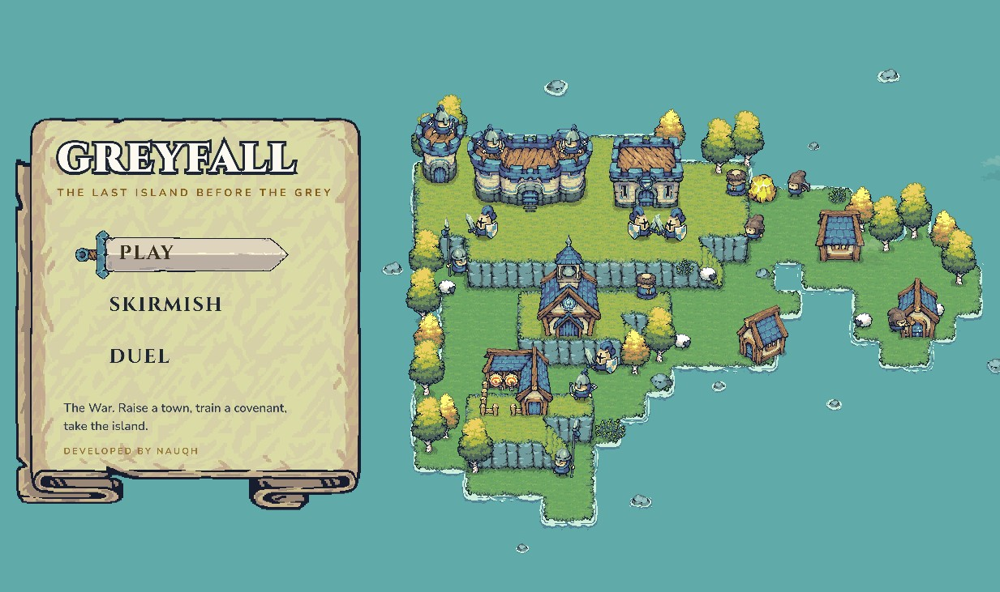

<div align="center">

# Greyfall

**The Atlas: a dark medieval action RPG in the Shattered Reach.**

[](https://github.com/nauqh/greyfall/actions/workflows/ci.yml)




</div>

The lords are ash. The Grey came out of the east, and the Gilded City
sent no aid. One fire remains, and a nameless survivor wakes beside it.

The Atlas is the focus: a Souls-structured action RPG in the Shattered Reach.
Come ashore at Last Harbour with no name and no lord, take the boss keys, open
the Grey Gate, and put an end to the Grey Warlord. The design is in
[ATLAS.md](ATLAS.md).

Greyfall is played in the browser, drawn entirely with Pixel Frog's
[Tiny Swords](https://pixelfrog-assets.itch.io/tiny-swords) pack, and headed
for Discord as an Activity that friends launch from a voice call.

## The Atlas

- **One world.** The Shattered Reach in three tiers: the sky, the surface, the
  underneath. Every area its own map, joined by gates and lifts. `/atlas`
  starts at the Landing; the world map opens from a bonfire.
- **Souls structure.** Bonfires, shortcuts, keys, bosses, and gold you drop
  when you die. A band of up to three: Lancer, Archer, Monk.
- **The Grey.** A condition, not an army. It crowned the Grey Warlord. The
  Gilded City shut its gates and sent no aid. The player is a nameless
  survivor.

## Other modes

The same engine runs two side modes: the real-time war (`/map`) and the auto
chess Versus (`/versus`), played solo against three clans (`/battle`) or one
against one over a room code. The design is in
[docs/skirmish.md](docs/skirmish.md).

## Current state

The Atlas is the focus. The Landing and Harbour are playable; the campaign is
built area by area: Emberwood and the Cinder Troll are the next slice.

The real-time war is playable solo against the red AI. Versus is auto chess:
three AI clans solo, or one against one online joined by a room code. Each
planning phase lasts 30s and ends early once both players are ready.

## Goals

- Finish the Atlas first slice: the Harbour, Emberwood, the Cinder Troll, the
  Troll Key.
- Then the rest of the Reach: Barrowmoor, the Tinker Crags, the Greyfall.
- Balance the war and give the AI real-time play of its own.
- Lockstep multiplayer on the island. The engine already takes commands
  between ticks, so this adds networking without touching the rules.
- Server-authoritative matches, with fog filtered per player and saved games.
- Launch as a Discord Activity with Discord sign-in, shareable replays and a
  leaderboard.
- A minimap, sound and polish.

## Play

| Mode | Route | |
| --- | --- | --- |
| Atlas | `/atlas` | The focus: the Souls action RPG in the Shattered Reach |
| Play | `/map` | The real-time war against the AI |
| Versus | `/versus` | Auto chess, solo (`/battle`) or online over a room code |

The Atlas controls are in [ATLAS.md](ATLAS.md). The war uses left click to
select and right click to order; **H** opens the field guide.

## Docs

| Doc | What it is |
| --- | --- |
| [ATLAS.md](ATLAS.md) | The Atlas: the game, the world, the areas, the opening. |
| [docs/atlas-map.md](docs/atlas-map.md) | The map reference: terrain, buildings, tests, dressing. |
| [docs/questline.md](docs/questline.md) | The folk's questline, generated from `npcs.ts`. |
| [docs/skirmish.md](docs/skirmish.md) | Skirmish: the auto chess mode. |


## Getting started

You need Node 24 and pnpm 10, plus AWS credentials that can read the art pack.
The pack's license forbids redistribution, so it is not in this repository; it
lives in a private S3 object and each machine fetches its own copy.

```bash
git clone https://github.com/nauqh/greyfall.git
cd greyfall
pnpm install
cp apps/web/.env.example apps/web/.env   # TINY_SWORDS_S3 is already set
pnpm dev                                 # fetches the pack, then starts Next
```

Versus keeps each room in the server process for the length of the match, so
it needs a single long-lived instance. Vercel's serverless functions are not
that: each instance would hold its own rooms.

Other scripts:

```bash
pnpm test                         # engine unit and property tests
pnpm typecheck                    # both packages
pnpm test:assets                  # every sprite path the game asks for exists
pnpm war -- --realtime --seed 3   # a real-time war, AI against AI, in the terminal
pnpm war -- --map                 # print the island
pnpm battle -- --seed 7 --moves   # one Skirmish battle in the terminal
pnpm assets                       # fetch and unpack the art pack
```

The CLIs need no art, so they are the quickest check that the engine works.

## Troubleshooting

**Blank board, 404s for `/tiny-swords/...`.** The art pack is missing. Check
`TINY_SWORDS_S3` and your AWS credentials, then run `pnpm assets`.

**`Region is missing`.** The SDK found no region. Set `AWS_REGION` or a
region in `~/.aws/config`.

**`Invalid character in header content`.** A placeholder AWS value is set in
`.env`. Leave those variables unset locally so `~/.aws` is used.

## Deployment

<details>
<summary>Environment variables and host setup</summary>

Set these in the host's environment (on Vercel, Project Settings >
Environment Variables), not in a file:

| Variable | Value |
| --- | --- |
| `TINY_SWORDS_S3` | `s3://greyfall-assets/tiny-swords/tiny-swords.zip` |
| `AWS_ACCESS_KEY_ID` | the deploy user's key |
| `AWS_SECRET_ACCESS_KEY` | its secret |
| `AWS_REGION` | `ap-southeast-1` |

- On Vercel, set the Root Directory to `apps/web`. A missing `TINY_SWORDS_S3`
  fails the build there rather than shipping a game with no art;
  `pnpm assets --require` does the same anywhere.
- The fetch script lives in `apps/web/scripts/`, because Vercel's Root
  Directory forbids reaching outside it with `..`. That once shipped a build
  with no art and no error.
- Give the deploy its own IAM user scoped to `s3:GetObject` on that one key.
- The SDK signs each request on purpose: a public object would be a
  redistributable copy, and a presigned URL expires within 7 days.
- CI needs none of this: the build never reads the art.
- Every pack request goes through `packUrl`, prefixed by
  `NEXT_PUBLIC_ASSET_BASE` (default `/tiny-swords`). A Discord Activity is
  proxied and needs `/.proxy/tiny-swords`.

There is one pack, `tiny-swords.zip`, zipped from the `tiny-swords/` folder at
the repo root. To change it, overwrite that object; `pnpm assets` (and so
`pnpm dev`) notices the new ETag and fetches it again:

```bash
powershell -Command "Compress-Archive -Force -Path tiny-swords\* -DestinationPath tiny-swords.zip"
aws s3 cp tiny-swords.zip s3://greyfall-assets/tiny-swords/tiny-swords.zip
```

</details>


## Technical foundation

| | |
| --- | --- |
| Engine | TypeScript with no dependencies, tested with Vitest and fast-check |
| Client | Next.js 15, React 19, Phaser 3.90 |
| API and data | tRPC, Zod, in-process room state |
| Tooling | pnpm workspaces, GitHub Actions |

```
packages/engine   the simulation: the Atlas world and game, the island, pathing
                  and vision, the tick-stepped war, the Skirmish battle,
                  balance tables, seeded rng, and the two CLIs
apps/web          the Next.js app: Phaser scenes for the title, the Atlas, the
                  island and the Skirmish board; React menus; tRPC and the
                  room Map for Versus
```

The engine steps at 10 ticks a second for the war and 20 for the Atlas, and
touches no I/O, so the same code can run on a server and keep every player's
view in agreement.


## Special thanks

- Pixel Frog, for Tiny Swords.
- [1500 Archers on a 28.8](https://www.gamedeveloper.com/programming/1500-archers-on-a-28-8-network-programming-in-age-of-empires-and-beyond)
  and [Fix Your Timestep!](https://gafferongames.com/post/fix_your_timestep/),
  the models the engine is built on.
